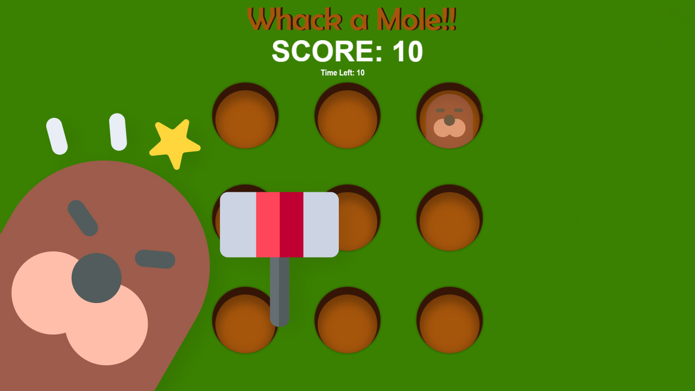

# Whack a Mole!

Permainan ketangkasan klasik berbasis web (HTML, CSS, dan Vanilla JavaScript). Pukul tikus tanah secepat mungkin sebelum mereka bersembunyi kembali ke dalam lubang!



## Fitur Utama

- **Landing Screen Interaktif**: Halaman awal sebelum bermain dengan maskot, aturan singkat, dan pengaturan permainan.
- **3 Tingkat Kesulitan**:
  - **Santai (Mudah)**: Durasi 45 detik dengan pergerakan tikus lebih lambat.
  - **Normal**: Durasi 30 detik dengan pergerakan standar.
  - **Kilat (Sulit)**: Durasi 25 detik dengan pergerakan cepat.
- **Sistem Kombo & Bonus Waktu**: Setiap pukulan tepat sasaran memberikan **+10 poin**, dan setiap 3 pukulan beruntun tanpa meleset memberikan bonus **+5 poin ekstra** serta **+1 detik** tambahan waktu.
- **Penyimpanan Skor Tertinggi**: Rekor skor tertinggi dan preferensi efek suara (`ON/OFF`) tersimpan otomatis di browser (`localStorage`).
- **Dukungan Multi-Kontrol & Responsif**:
  - Klik mouse (dengan kursor palu khusus di desktop).
  - Layar sentuh untuk perangkat mobile/tablet.
  - Tombol keyboard angka `1` sampai `9` untuk memukul lubang 1-9, serta `Escape` untuk menjeda permainan.

## Cara Menjalankan Secara Lokal

Cukup buka file `index.html` menggunakan browser modern, atau jalankan server statis lokal:

```bash
npx serve .
```
